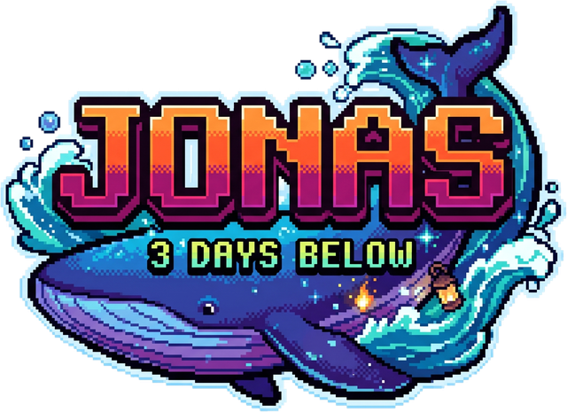

# Jonas: 3 Days Below

Survival em pixel art inspirado no relato bíblico de Jonas: três dias e três noites dentro do grande peixe.

- Câmera 3/4, mundo orgânico que respira e se contorce (Diretor Orgânico)
- 18 criaturas, 6 por dia
- 25 receitas de crafting e interações com o cenário (respiradouros, nervos, esporos, bile)
- 9 lembranças e 6 reflexões
- Salvamento automático e 3 espaços de salvamento
- Trilha sonora procedural, combate com rolamento e combos
- Dicas guiadas no Dia 1 (dá para desligar em Ajustes)
- Epílogo em Nínive (Jonas 3–4): a proclamação, o rei, a enramada, a planta, o verme e a última pergunta
- Missões narrativas dos três dias e oração final inspirada em Jonas 2

## Jogar

Abra `index.html` no navegador, ou acesse a versão publicada no GitHub Pages.

**Controles:** WASD/setas para andar · Espaço para atacar · Shift para rolar · R para trocar de arma · E para interagir · Esc/Tab para pausar (criar, mochila, diário, mapa, salvar) · 1–0 para usar itens · M para o mapa · B para o bestiário. No celular, joystick e botões na tela.
